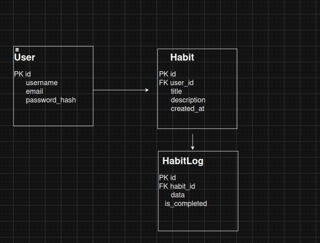

# HabitTracker API

## 1. Проєкт та ідея
Створюємо вебзастосунок для тренування корисних звичок і стеження за своїм прогресом. 
Основна ідея — допомогти користувачам не закидати свої цілі (наприклад, пити воду, читати чи займатися спортом або нові 
глобальні цілі), бачити свої успіхи та щодня вести облік.

**Що буде реалізовано:**
- Реєстрація та вхід в систему.
- Головна сторінка зі списком звичок на сьогодні.
- Кнопка для додавання нової звички або видалення старих.
- Відмітка про виконання звички за день.
- Простий розділ статистики (щоб бачити свої серії виконання).

---

## 2. Ендпоінти REST API

Обмін даними між клієнтом і сервером йде у форматі JSON.

### Ресурс: `habits` (Звички)

#### Отримати список усіх звичок
- **Призначення:** Завантажує всі звички користувача для головної сторінки.
- **Method:** `GET`
- **Endpoint:** `/api/v1/habits/`
- **Response Status:** `200 OK`
- **Response Body:**
  ```json
  [
    {
      "id": 1,
      "title": "Ранкова зарядка",
      "description": "15 хвилин розминки",
      "created_at": "2026-10-13"
    }
  ]
  
#### Створити нову звичку
- **Призначення:** Додає нову звичку через форму на сайті.
- **Method:** `POST`
- **Endpoint:** `/api/v1/habits/`
- **Response Status:** `201 Created`
- **Response Body:**
  ```json
  [
    {
      "id": 2,
      "title": "Читання",
      "description": "Читати 30 хвилин на день",
      "created_at": "2026-10-13"
    }
  ]
  
#### Подивитися одну звичку
- **Призначення:** Відкриває детальну інфу по конкретній звичці.
- **Method:** `GET`
- **Endpoint:** `/api/v1/habits/1/`
- **Response Status:** `200 OK`
- **Response Body:**
  ```json
  [
    {
      "id": 1,
      "title": "Ранкова зарядка",
      "description": "15 хвилин розминки",
      "created_at": "2026-10-13"
    }
  ]
  
#### Змінити звичку
- **Призначення:** Оновлює опис або назву звички.
- **Method:** `PATCH`
- **Endpoint:** `/api/v1/habits/1/`
- **Request Body:** `{ "description": "20 хвилин розминки та йоги" }`
- **Response Status:** `200 OK`
- **Response Body:**
  ```json
  [
    {
      "id": 1,
      "title": "Ранкова зарядка",
      "description": "20 хвилин розминки та йоги",
      "created_at": "2026-10-13"
    }
  ]
  
#### Видалити звичку
- **Призначення:** Видаляє звичку з бази.
- **Method:** `DELETE`
- **Endpoint:** `/api/v1/habits/1/`
- **Response Status:** `204 No Content`
- **Response Body:** `відсутній`

### Ресурс: logs (Історія виконання)

#### Позначити звичку виконаною
- **Призначення:** Зберігає відмітку про те, що звичку зробили в конкретний день.
- **Method:** `POST`
- **Endpoint:** `/api/v1/habits/1/logs/`
- **Request Body:** `{ "date": "2026-10-13", "is_completed": true }`
- **Response Status:** `201 Created`
- **Response Body:**
  ```json
  [
    {
      "id": 10,
      "habit_id": "1",
      "date": "2026-10-13",
      "is_completed": "true"
    }
  ]
  

## 3. Схема бази даних
Реляційна структура бази даних (таблиці `users`, `habits`, `habit_logs` та зв'язки між ними):


---

> **TODO:** доробити логіку підрахунку серій підряд (streaks) виконання звичок.  
> **TBD:** уточнити щодо винесення логів у окрему таблицю для архівування також можливо щось нове додати.